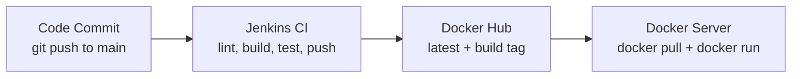

# DevOps Intern Task (Node.js + Jenkins)

A minimal Node.js web app, containerized with Docker, built and published to Docker Hub by a Jenkins pipeline, plus a Bash script that logs basic system health.

## Repository structure

```
.
├── app.js                # Node.js app (GET / returns JSON), no dependencies
├── package.json          # Scripts: start, lint
├── Dockerfile            # Multi-stage, non-root image
├── docker-compose.yml    # Run locally on port 8080
├── Jenkinsfile           # Jenkins CI pipeline
├── system_health.sh      # CPU / memory / disk logger
├── docs/workflow.svg     # Workflow diagram
├── .dockerignore
└── .gitignore
```

> Jenkins pipelines are defined in a `Jenkinsfile` at the repository root (not in `.github/workflows/`, which is GitHub Actions only).

## 1. Run the app with Docker Compose

Requirements: Docker with the Compose plugin.

```bash
docker compose up --build
```

(With the older standalone binary: `docker-compose up --build`.)

In another terminal:

```bash
curl http://localhost:8080/  or In Crome Browser: http://server_IP:8080
```

Expected response:

```json
{"message":"Hello from DevOps Intern Task!","status":"running"}
```

Stop with `Ctrl+C`, or `docker compose down` if started with `-d`.

To run without Docker: `npm start` (needs Node.js 20+).

### Docker best practices used

- **Multi-stage build**: the builder stage verifies the code (`npm run lint`) and the final stage copies in only the files needed at runtime.
- **Lightweight base image**: `node:22-alpine`.
- **Non-root user**: runs as the built-in unprivileged `node` user.
- **Layer caching**: `package.json` is copied before the app code.
- **Zero dependencies**: the app uses Node's built-in `http` module, so the image has no `node_modules` and a small attack surface.
- **Container hygiene**: `.dockerignore`, `HEALTHCHECK`, `init: true`, graceful SIGTERM shutdown, read-only root filesystem and `no-new-privileges` in Compose.

## 2. CI pipeline (Jenkins)

The pipeline is defined in `Jenkinsfile` and is triggered by a GitHub webhook on every push. Stages:

1. **Checkout**: gets the code and computes an image tag (`<build number>-<git sha>`).
2. **Lint: Node.js / Lint: Bash**: `node --check` on the app (inside a `node:22-alpine` container) and `bash -n` on the health script.
3. **Build Docker Image**: builds the image to verify there are no build errors.
4. **Smoke Test**: starts the container and checks that `GET /` responds.
5. **Push to Docker Hub** (main branch only): pushes `:<tag>` and `:latest`.
6. **Deploy to Docker Server** (main branch only, optional): SSHes to the Docker server, pulls the new image and restarts the container. Disabled until `DEPLOY_ENABLED` is set to `'true'` in the `Jenkinsfile`.

### Jenkins setup

1. Install on the Jenkins server: Docker, and the plugins Pipeline, Git, GitHub, Docker Pipeline, Credentials Binding and SSH Agent. Add the `jenkins` user to the `docker` group.
2. Add credentials (*Manage Jenkins > Credentials*):
   - `dockerhub-credentials`: type *Username with password* (Docker Hub username and an access token).
   - `docker-server-ssh`: type *SSH Username with private key* (only needed for deployment).
3. Create a *Pipeline* job (or Multibranch Pipeline) using *Pipeline script from SCM*, pointing at this repo and the `main` branch, with script path `Jenkinsfile`.
4. In the GitHub repo, add a webhook: `http://<jenkins-url>/github-webhook/`, content type `application/json`, event *Just the push event*.
5. Make the Docker Hub repository `<username>/devops-intern-app` public.

### Workflow diagram




## 3. Bash script: `system_health.sh`

Checks CPU usage, memory usage and disk usage (of `/`), prints the result and appends a timestamped line to `health_log.txt` (created next to the script).

```bash
chmod +x system_health.sh
./system_health.sh
cat health_log.txt
```

Example log line:

```
[2026-11-06 00:41:30] CPU: 56% | MEM: 42% | DISK: 42%
[2026-11-06 23:04:09] CPU: 2% | MEM: 27% | DISK: 38%
[2026-11-06 23:04:16] CPU: 6% | MEM: 27% | DISK: 38%
[2026-11-06 23:04:17] CPU: 3% | MEM: 27% | DISK: 38%
[2026-11-06 23:04:20] CPU: 3% | MEM: 27% | DISK: 38%
```

If disk usage is above 80%, it prints `[WARNING] Disk space high!` and also records the warning in the log line.

To run it every 5 minutes, add this with `crontab -e`:

```
*/5 * * * * /root/system_health.sh
```

The script needs Linux (it reads `/proc/stat` and `/proc/meminfo`).

## 4. How would you deploy this container to a Docker server?

- **Prepare the server**: install Docker on a Linux host, create a limited `deploy` user in the `docker` group, allow SSH key login for it, and open only the needed ports (22 from trusted IPs, 8080 or 80/443 for the app).
- **Ship the image through Docker Hub**: Jenkins already pushes a tagged image after every green build, so the server never builds anything. It runs `docker pull <user>/devops-intern-app:<tag>`, removes the old container and starts the new one with `docker run -d --restart unless-stopped -p 8080:8080`. Deploying a specific build tag instead of `latest` makes releases traceable and rollback a one-line change.
- **Automate and verify**: the optional final pipeline stage does this over SSH using a key stored in Jenkins credentials. After deploying I would check `curl http://<server>:8080/` and `docker ps` (the image's `HEALTHCHECK` reports health), and put Nginx with HTTPS in front for real traffic.
